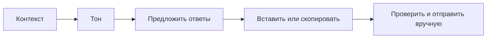

# ReplyLab

Подсказки прямо у поля сообщения в чате Tinder. Локальные примеры или ваш GPT.

[English](docs/README.en.md) · [Свой GPT и сценарии доступа](docs/development.ru.md) · [Схема](docs/architecture.md)

**[Скачать ReplyLab 0.2.0](https://github.com/kostia7alania/replylab-extension/releases/latest/download/ReplyLab-0.2.0.zip)**


*Проверка на локальном макете чата.*

## Запуск за 3 шага

| Шаг | Что сделать |
|---|---|
| **1. Установить** | Распакуйте ZIP. В `chrome://extensions` включите **Режим разработчика** → **Загрузить распакованное расширение** → выберите папку с `manifest.json`. |
| **2. Включить** | Откройте ReplyLab на панели расширений. Введите код ниже и нажмите **Включить тест**. |
| **3. Открыть чат** | Откройте чат Tinder (`/app/messages/...`) и обновите вкладку. Панель ReplyLab появится рядом с полем сообщения. |

**Обновление с 0.1.0:** замените файлы в прежней папке расширения файлами из нового ZIP, нажмите значок перезагрузки на карточке ReplyLab в `chrome://extensions`, затем обновите вкладку чата.

<details>
<summary>Где включить режим разработчика</summary>


</details>

```text
REPLYLAB-LOCAL
```

Код включает локальный тестовый доступ. Для этого режима не нужны аккаунт или API-ключ.



## Как пользоваться в чате

| Действие | Результат |
|---|---|
| Ввести черновик, выделить текст или заполнить **Контекст** | Подготовить фрагмент для ответа |
| Выбрать тон → **Предложить ответы** | Получить три варианта |
| **Вставить** / **Копировать** | Перенести выбранный вариант в поле / буфер обмена |
| **Заменить черновик** | Подтвердить замену уже введённого текста |
| **Настроить ReplyLab** | Открыть источник ответов и локальные сценарии доступа |

Контекст берётся из первого непустого источника: **черновик → выделенный текст страницы → поле Контекст**. Отправку сообщения выполняете вы.

<details>
<summary>Проверить без страницы чата</summary>

В окне расширения: **Пример** → **Предложить ответы**. Здесь же доступны **Из выделения** и сценарии **Открыт**, **Пробный**, **Истёк**, **Выход**.


</details>

## Подключить свой GPT

**Node.js 22+** → запустить локальный коннектор → **Источник: Свой GPT** → указать точный ID модели → **Разрешить локальный коннектор**.

[Команды и настройка](docs/development.ru.md#подключить-свой-gpt). Выбранный источник и модель сохраняются для окна расширения и панели в чате. API-ключ остаётся в локальном коннекторе. Запрос выполняется после нажатия **Предложить ответы**.

## Возможности 0.2.0

| Есть | Граница |
|---|---|
| Панель на `/app/messages/...` | Нужен один видимый редактируемый `textarea` |
| Ручной контекст, тон, вставка и копирование | Полная история и профиль автоматически не извлекаются |
| Локальные fixtures или сохранённый источник GPT | По умолчанию **Локальный тест**, без сети |

Это реализация части функций помощника. Скриншот получен на локальном макете; совместимость с текущей вёрсткой реального сайта проверяется отдельно.

Исходники: [`extension/`](extension/). Контракт тестового доступа: [`canUseApp(user)`](extension/core.js). Проверки: `npm test`.
