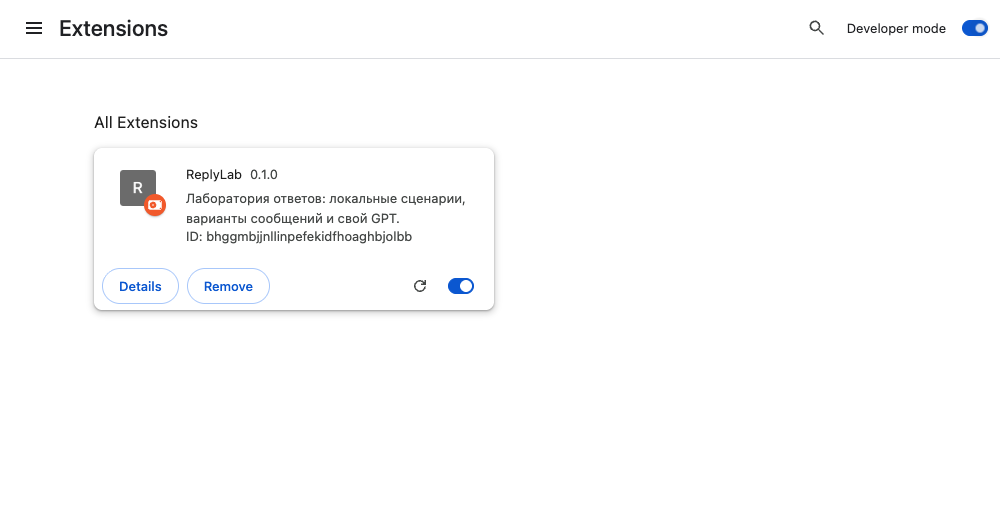
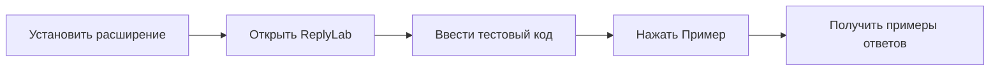
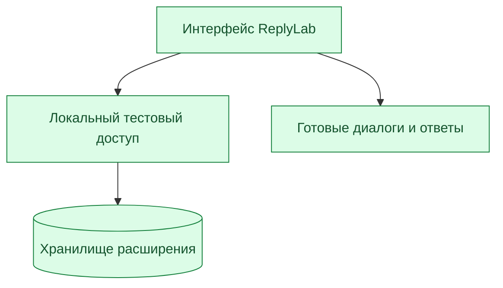

# ReplyLab

Лаборатория ответов в Chrome: локальный тест или ваш GPT.

[English](docs/README.en.md) · [Свой GPT и сценарии доступа](docs/development.ru.md) · [Схема](docs/architecture.md)

**[Скачать ZIP для установки](https://github.com/kostia7alania/replylab-extension/releases/latest/download/ReplyLab-0.1.0.zip)**


## Запуск за 3 шага

| Шаг | Что сделать |
|---|---|
| **1. Установить** | Скачайте и распакуйте репозиторий. Откройте `chrome://extensions`, включите **Режим разработчика**, нажмите **Загрузить распакованное расширение** и выберите папку `extension`. |
| **2. Открыть** | Нажмите значок ReplyLab на панели расширений Chrome. |
| **3. Проверить** | Введите код ниже, нажмите **Включить тест**, затем **Пример** и **Предложить ответы**. |

<details>
<summary>Где включить режим разработчика</summary>



</details>

```text
REPLYLAB-LOCAL
```

Код включает локальный тестовый доступ. Для этого режима не нужны аккаунт или API-ключ.



## Что проверять

| Сценарий | Назначение |
|---|---|
| **Пример** → **Предложить ответы** | Три готовых ответа для проверки интерфейса |
| **Копировать** | Перенести выбранный ответ в буфер обмена |
| **Из выделения** | Взять выделенный фрагмент из открытой страницы |
| **Сценарии доступа** | **Открыт**, **Пробный**, **Истёк**, **Выход** |

По умолчанию выбран **Локальный тест**: готовые ответы, без сетевых запросов. Код действует только в локальном тестовом профиле.

## Подключить свой GPT

**Node.js 22+** → запустить локальный коннектор → **Источник: Свой GPT** → указать точный ID модели → **Разрешить локальный коннектор**.

[Команды и настройка](docs/development.ru.md#подключить-свой-gpt). API-ключ остаётся в локальном процессе; расширение его не хранит. Реальный запрос выполняется после нажатия **Предложить ответы**.

## Что внутри



Исходники: [`extension/`](extension/). Контракт тестового доступа: [`canUseApp(user)`](extension/core.js). Проверки: `npm test`.
