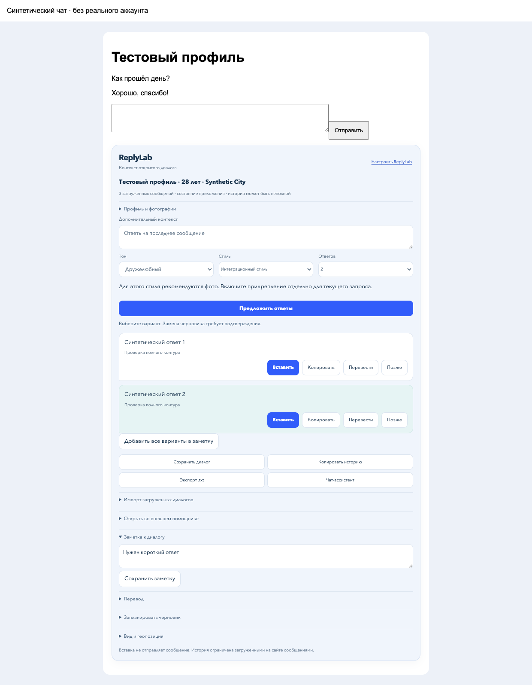
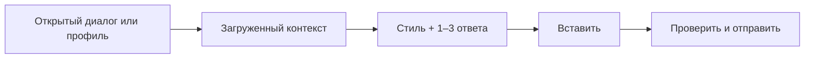
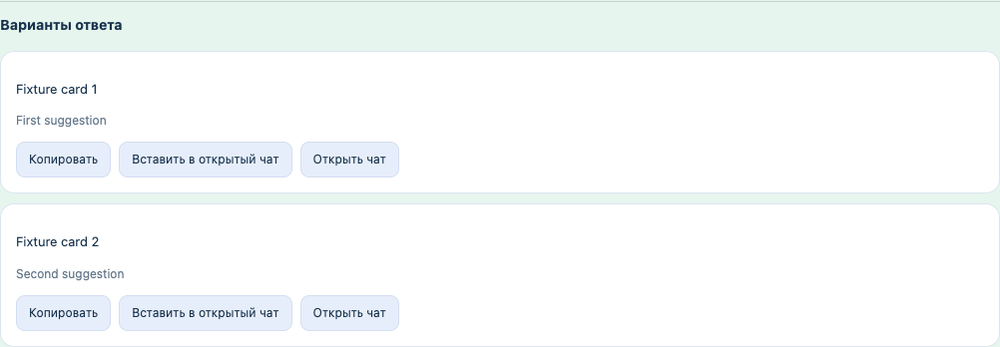
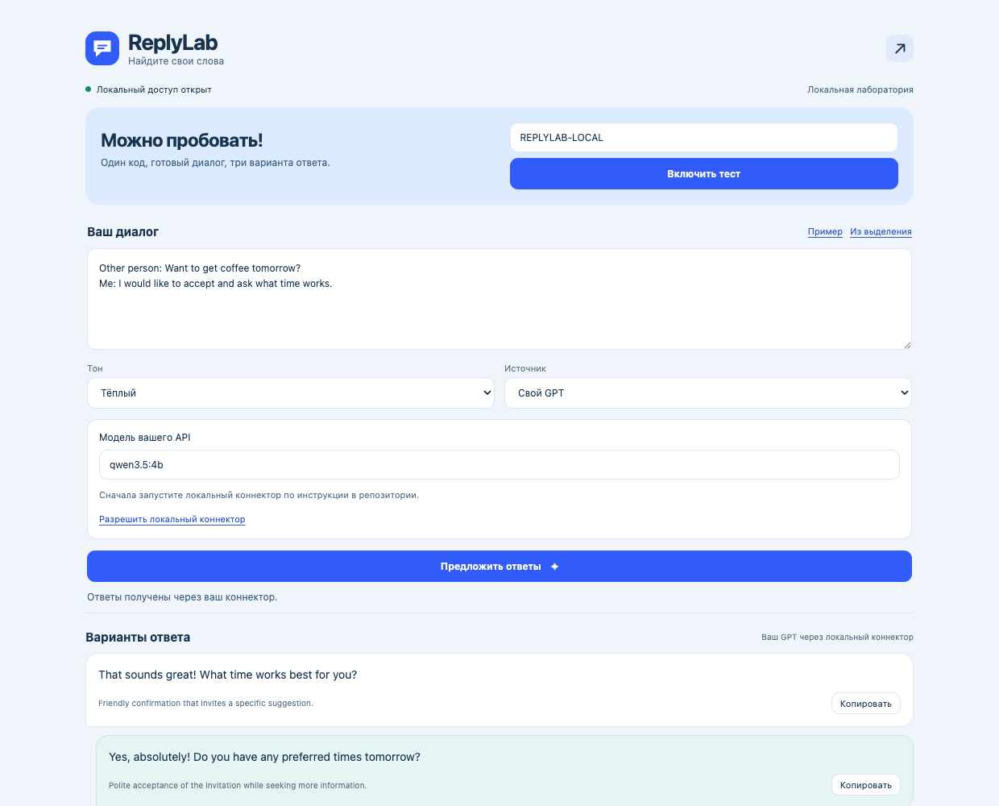

# ReplyLab

Помощники у поля сообщения в Tinder и WhatsApp Web: контекст, свои стили, подсказки и история.

[English](docs/README.en.md) · [GPT и локальные тесты](docs/development.ru.md) · [Возможности и проверки](docs/features.md) · [Исследование аналогов](docs/research.ru.md) · [Новое в 0.4](docs/changes-0.4.ru.md)

**[Скачать 0.4.0](https://github.com/kostia7alania/replylab-extension/releases/latest/download/ReplyLab-0.4.0.zip)**



*Скриншоты и браузерные проверки используют синтетические данные.*

## Установка за 3 шага

| ① Скачать | ② Загрузить | ③ Проверить |
|---|---|---|
| Распаковать ZIP | `chrome://extensions` → **Режим разработчика** → **Загрузить распакованное расширение** → папка **ReplyLab/extension** | Открыть ReplyLab → ввести код → **Включить тест** → **Пример** → **Предложить ответы** |

```text
REPLYLAB-LOCAL
```

В локальном режиме аккаунт и ключ не нужны. Ответы здесь являются фиксированными примерами для проверки интерфейса.

<details><summary>Где включить режим разработчика</summary>


</details>

Обновление: замените файлы в прежней папке расширения, нажмите перезагрузку на его карточке, обновите вкладку чата.

## Внутри чата



| Где | Что сделать |
|---|---|
| **Tinder** | Открыть диалог или карточку профиля, обновить страницу |
| **WhatsApp Web** | В ReplyLab раскрыть **Подключения и разрешения** → **Включить WhatsApp Web** → обновить WhatsApp |
| **Панель** | Выбрать стиль и количество → **Предложить ответы** → **Вставить** или **Копировать** |
| **Студия** | Кнопка ↗: AI-помощник с карточками ответов, стили, история, графики, расписание, настройки |

Читается только загруженная часть текущего диалога. Если внутренний адаптер сайта недоступен, панель показывает ограничение и использует видимый контекст. Непустой черновик заменяется после подтверждения. После **Сохранить диалог** загруженные обновления этого же подтверждённого аккаунта сохраняются локально. Для архива WhatsApp сначала задайте отдельную локальную метку аккаунта; она не подтверждает его личность.



Карточки можно скопировать или передать в нужный открытый чат. Предложенный AI стиль сначала открывается в редакторе для проверки.

## Свой AI

| Вариант | Подключение |
|---|---|
| OpenAI API / OpenRouter | Ваш ключ на вашем локальном сервере |
| ChatGPT / OpenRouter OAuth | Вход через официальную страницу, токены на локальном сервере |
| Ollama / совместимый API | Свой endpoint и модель, для loopback ключ не обязателен |

Из распакованной папки **ReplyLab**: `npm start` (Node.js 22+). Затем **Подключения и разрешения** → **Разрешить мой сервер**, **Источник: Свой GPT**, **Настройки** → провайдер и точные ID моделей. [Пошагово и команды](docs/development.ru.md).

Локальный код не предоставляет внешнюю модель. Фото прикрепляются к AI-запросу только при отдельном выборе. Синхронизация и автоматическая отправка изначально выключены; разрешение требуется на каждом устройстве.

Автоотправка работает только для явно выбранных записей при открытом видимом чате и неизменившихся входящих сообщениях. Сейчас она доступна только при подтверждённом аккаунте Tinder; WhatsApp остаётся в режиме черновиков. Поддерживаемые платформы могут ограничивать сторонние интеграции. Гарантии отсутствия блокировок нет. [Проверенные источники и ограничения](docs/research.ru.md).

Проверки: `npm test`. Зависимости для запуска расширения и сервера не требуются. [Архитектура](docs/architecture.md).

Проверена и настоящая генерация через локальную **qwen3.5:4b**: два ответа за **2,2 с** на загруженной модели и синтетическом тексте. Это один smoke test, не общий benchmark.


