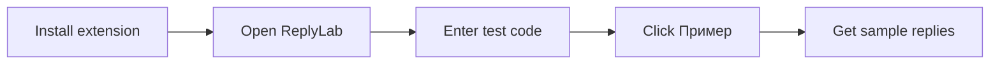
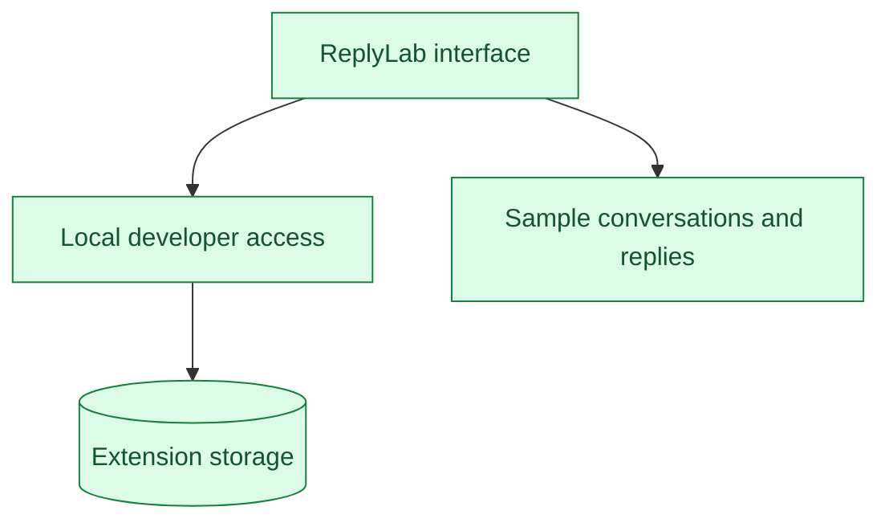

# ReplyLab

A reply lab in Chrome: local fixtures or your own GPT.

[Русский](../README.md) · [Application flow](architecture.md)


## Start in 3 steps

| Step | Action |
|---|---|
| **1. Install** | Download and extract the repository. Open `chrome://extensions`, enable **Developer mode**, click **Load unpacked** and select the `extension` folder. |
| **2. Open** | Click ReplyLab in the Chrome extensions toolbar. |
| **3. Try** | Enter the code below, click **Включить тест**, then **Пример** and **Предложить ответы**. |

```text
REPLYLAB-LOCAL
```

This code enables local developer access. No account or API key is required for this mode.



## Test scenarios

| Scenario | Purpose |
|---|---|
| **Пример** → **Предложить ответы** | Load the sample, then show three fixture replies |
| **Копировать** | Copy the selected reply |
| **Из выделения** | Import selected text from the active page |
| **Сценарии доступа** | **Открыт** (active), **Пробный** (trial), **Истёк** (expired), **Выход** (sign out) |

The default **Локальный тест** mode uses fixtures without network requests. The code applies only to the local test profile.

## Connect your GPT

Requires **Node.js 22+** and a valid API key. From the repository folder:

```sh
read -s OPENAI_API_KEY
export OPENAI_API_KEY
npm start
```

Enter your key after the first command and press Enter; the input stays hidden. The key remains in the local connector process and is never stored in the extension.

| UI control | Action |
|---|---|
| **Источник** | Select **Свой GPT** |
| **Модель вашего API** | Enter the exact model ID available to your API account |
| **Разрешить локальный коннектор** | Grant access to `http://127.0.0.1:4318` |
| **Предложить ответы** | Send the current conversation through your connector |

The connector uses the [official Chat Completions API](https://developers.openai.com/api/reference/resources/chat/subresources/completions/methods/create). The local test code does not provide external API access. Stop the connector with Ctrl+C.

Only fixtures and a local API stub have been tested; a real GPT call is a separate check.

## Inside the extension



Source: [`extension/`](../extension/). Developer access contract: [`canUseApp(user)`](../extension/core.js). Run checks with `npm test`.
