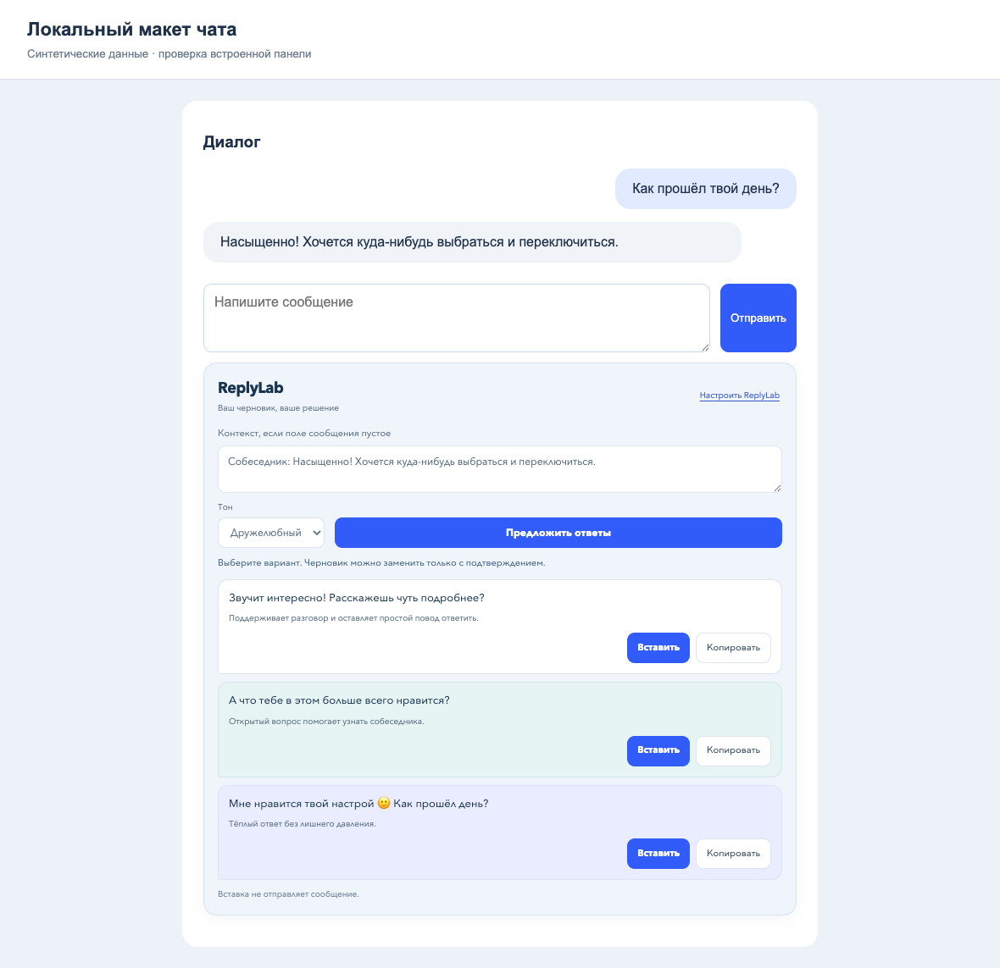
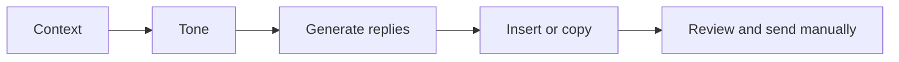
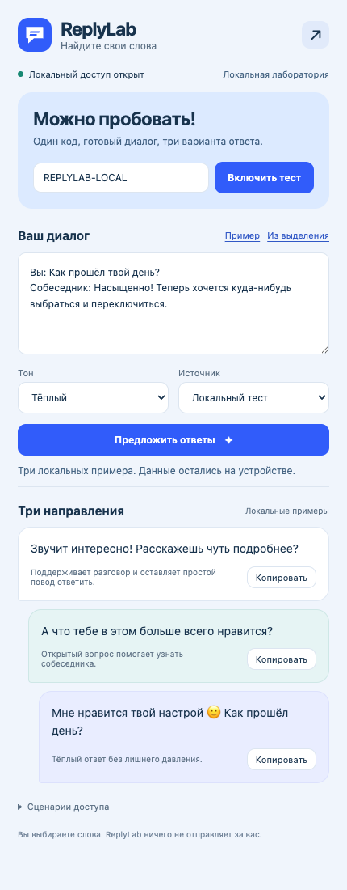

# ReplyLab

Reply suggestions next to the message field in a Tinder chat. Local fixtures or your GPT.

[Русский](../README.md) · [Application flow](architecture.md)

**[Download ReplyLab 0.2.0](https://github.com/kostia7alania/replylab-extension/releases/latest/download/ReplyLab-0.2.0.zip)**



*Local chat fixture. This is not a live account screenshot.*

## Start in 3 steps

| Step | Action |
|---|---|
| **1. Install** | Extract the ZIP. Open `chrome://extensions`, enable **Developer mode**, click **Load unpacked** and select the folder containing `manifest.json`. |
| **2. Enable** | Open ReplyLab from the extensions toolbar, enter the code below and click **Включить тест**. |
| **3. Open a chat** | Open a Tinder chat at `/app/messages/...` and refresh the tab. ReplyLab appears next to the message field. |

**Updating from 0.1.0:** replace the files in the existing extension folder with those from the new ZIP, click **Reload** on its `chrome://extensions` card, then refresh the chat tab.

```text
REPLYLAB-LOCAL
```

This code enables local developer access. No account or API key is required for this mode.



## Use it in a chat

| Control | Result |
|---|---|
| Draft, selected page text or **Контекст** | Supply the text to respond to |
| Tone → **Предложить ответы** | Generate three suggestions |
| **Вставить** / **Копировать** | Insert a suggestion / copy it |
| **Заменить черновик** | Confirm replacing a non-empty draft |
| **Настроить ReplyLab** | Open the source and local access settings |

Context uses the first non-empty value: **draft → selected page text → panel context field**. ReplyLab never sends the message for you.

<details>
<summary>Try it without a chat page</summary>

In the extension window, click **Пример** → **Предложить ответы**. It also provides **Из выделения** and **Сценарии доступа**: **Открыт** (active), **Пробный** (trial), **Истёк** (expired), **Выход** (sign out).



</details>

## Connect your GPT

Requires **Node.js 22+** and a valid API key. From the repository folder:

```sh
read -s OPENAI_API_KEY
export OPENAI_API_KEY
npm start
```

Enter your key after the first command and press Enter; the input stays hidden. The key remains in the local connector process and is never stored in the extension.

| UI control | Action |
|---|---|
| **Источник** | Select **Свой GPT** |
| **Модель вашего API** | Enter the exact model ID available to your API account |
| **Разрешить локальный коннектор** | Grant access to `http://127.0.0.1:4318` |
| **Предложить ответы** | Send the current conversation through your connector |

The connector uses the [official Chat Completions API](https://developers.openai.com/api/reference/resources/chat/subresources/completions/methods/create). The local test code does not provide external API access. Stop the connector with Ctrl+C.

The selected source and model are shared by the extension window and the chat panel through the background worker. Only fixtures and a local API stub have been tested; a real GPT call is a separate check.

## Version 0.2.0 scope

| Available | Boundary |
|---|---|
| Panel on `/app/messages/...` | Requires one visible, editable `textarea` |
| Manual context, tone, insert and copy | No automatic full-history or profile extraction |
| Local fixtures or the saved GPT source | Defaults to **Локальный тест**, without network requests |

This implements part of a reply assistant. The screenshot comes from a local fixture; compatibility with the current live page layout is a separate check.

Source: [`extension/`](../extension/). Developer access contract: [`canUseApp(user)`](../extension/core.js). Run checks with `npm test`.
