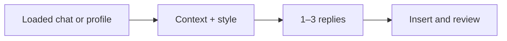
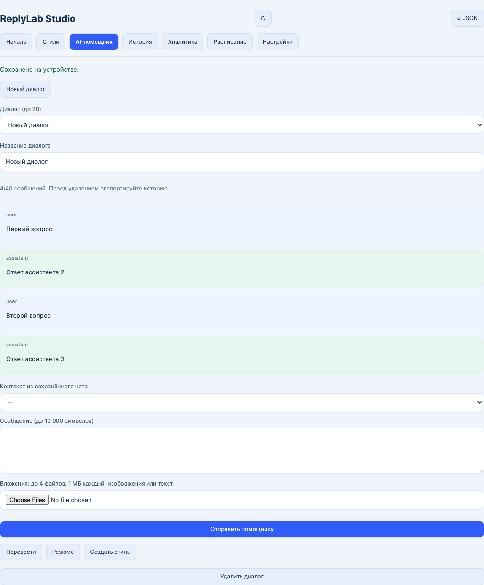

# ReplyLab

Inline reply helpers for Tinder and WhatsApp Web, with custom styles, conversation context and a local library.

[Русская инструкция](../README.md) · [Capabilities and verification](features.md) · [Research and limitations (RU)](research.ru.md)

**[Download 0.3.0](https://github.com/kostia7alania/replylab-extension/releases/latest/download/ReplyLab-0.3.0.zip)**

| 1. Extract | 2. Install | 3. Try |
|---|---|---|
| Unzip the download | `chrome://extensions` → Developer mode → Load unpacked → **ReplyLab/extension** | Open ReplyLab → enter `REPLYLAB-LOCAL` → enable local test → load the sample → suggest replies |

Local mode uses fixed examples and requires no account or API key. Open a supported conversation and reload the tab. For WhatsApp, first grant access using **Подключения и разрешения → Включить WhatsApp Web**. The studio and inline panel support multiple interface languages; choose English under **Настройки → Язык**.

## Your model

Run `npm start` from **ReplyLab** using Node.js 22+. No dependency installation or build is required. Grant the extension access to `http://127.0.0.1:4318`, choose your provider and exact model IDs, then select **Свой GPT** as the response source.

| Provider | Setup |
|---|---|
| OpenAI API | Set `OPENAI_API_KEY` before starting the server |
| OpenRouter | Set `OPENROUTER_API_KEY`, or sign in through OAuth |
| ChatGPT | Use the official OAuth flow in studio settings; direct inference availability depends on account permissions |
| Ollama / compatible | Set `COMPATIBLE_API_BASE=http://127.0.0.1:11434/v1`; loopback endpoints may omit an API key |

API keys and OAuth credentials stay on your server. Library exports exclude them. Local test access does not grant external model access. [Detailed commands and storage behavior (RU)](development.ru.md).

## Behavior and limits

Custom styles, notes, memories, assistant chats, imported conversations, analytics and scheduling share one validated local library. Optional sync, search and expiring share links use your server. Only loaded conversation history can be captured. Photo upload is an explicit per-request choice. Replacing a draft requires confirmation.

Automatic sending starts disabled and requires separate consent on each device. It only attempts explicitly marked automatic items in a visible matching conversation with unchanged incoming messages and no existing draft. WhatsApp automatic sending stays blocked until a reliable self-account identity source is verified. Platform rules can restrict third-party integrations; no ban-free guarantee is offered. [Primary sources](research.ru.md#почему-паузы-не-дают-защиты-от-блокировки).

Validation: `npm test`. The optional `tests/browser.mjs` exercises the actual extension worker and HTTP server against synthetic site state and mocked AI transport. Live account compatibility and live OAuth access remain separate checks.
