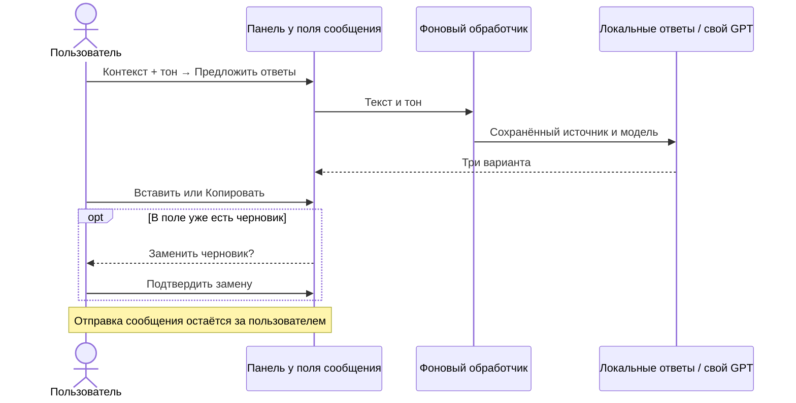
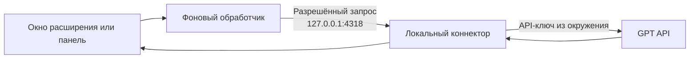

# Как работает ReplyLab

[← На главную](../README.md) · [English](README.en.md)

## Панель внутри чата

ReplyLab подключает панель к странице Tinder `/app/messages/...`, если найден один видимый редактируемый `textarea` в области чата. При смене страницы или поля панель создаётся заново.

| Контекст | Приоритет |
|---|---|
| Черновик в поле сообщения | 1 |
| Выделенный текст страницы | 2, если черновик пуст |
| Поле **Контекст** в панели | 3, если нет первых двух |

Полная история переписки и профиль автоматически не извлекаются. Вставка меняет только текст `textarea` и не нажимает отправку. Изменившийся черновик нужно подтвердить заново.

| Код | Задача |
|---|---|
| [`content.js`](../extension/content.js) | Панель, ручной контекст, тон, подтверждение замены |
| [`page-adapter.js`](../extension/page-adapter.js) | Поиск поля и вставка текста |
| [`background.js`](../extension/background.js) | Проверка источника сообщения, чтение сохранённых настроек |
| [`generation.js`](../extension/generation.js) | Общая генерация для окна расширения и панели |

## Свой GPT

| Режим | Данные и доступ |
|---|---|
| **Локальный тест** | Fixtures, тестовый код `REPLYLAB-LOCAL`, без сети |
| **Свой GPT** | Текст текущего диалога, ваш API-ключ в локальном процессе, модель с указанным ID |

Проверка локального доступа находится в [`canUseApp(user)`](../extension/core.js). Она использует данные тестового профиля. Сценарии **Открыт**, **Пробный**, **Истёк**, **Выход** меняют только этот профиль.

Инструкция по коннектору: [подключить свой GPT](development.ru.md#подключить-свой-gpt). Макет чата и локальный API stub позволяют проверять клиентский сценарий; реальная страница и реальный GPT остаются отдельными проверками.
