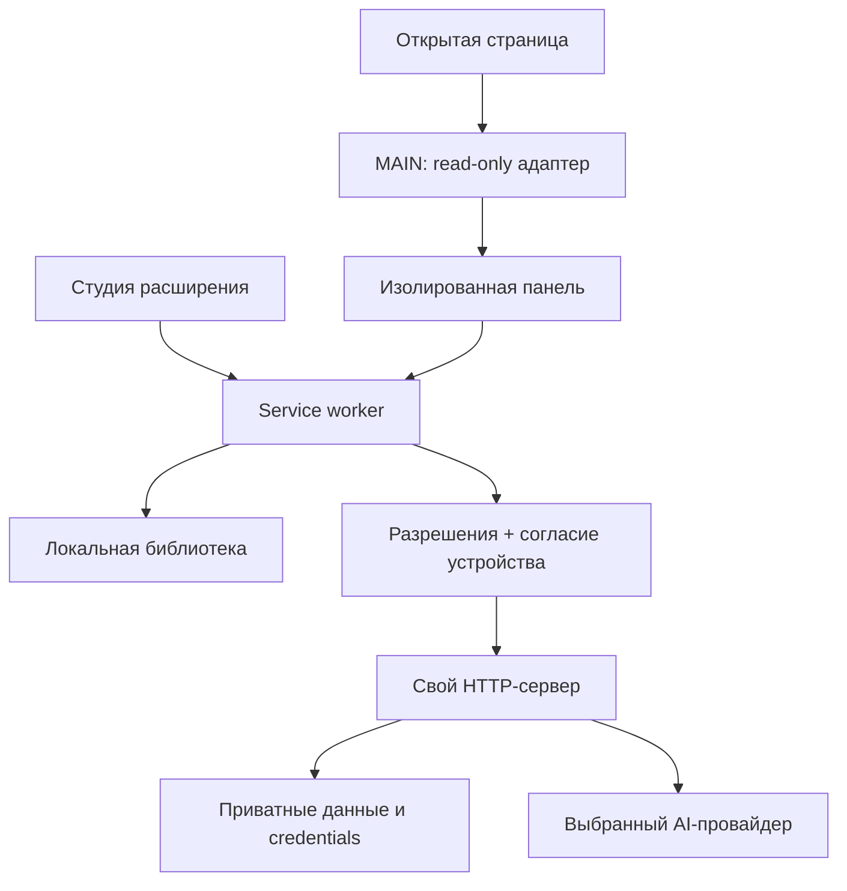

# Устройство ReplyLab

[Главная](../README.md) · [Контракты и проверки](features.md)

| Модуль | Ответственность |
|---|---|
| `site-bridge.js`, `site-context.js` | Загруженный текущий чат/профиль, источник и неполнота данных |
| `content.js`, `page-adapter.js` | Панель, вставка, черновики, расписание, смена SPA-маршрута |
| `background.js` | Разрешённые RPC, очередь библиотеки, streaming ports, согласие устройства |
| `library.js`, `workspace.js`, `locales.js` | Схема, merge/tombstones, CRUD, история, студия и языки |
| `generation.js`, `server-client.js` | Шаблоны, контекст, фото по выбору, разрешённый сервер |
| `scripts/gateway.mjs`, `server-store.mjs` | Sync/search/shares/analytics, сериализованный claim расписания |
| `scripts/providers.mjs`, `oauth.mjs` | AI-контракты, валидация потока, OAuth PKCE, refresh/revoke |

Долговременное состояние сохраняется в storage/файлы. Незавершённые потоки прерываются при отключении port. Неполный SSE-ответ считается ошибкой. Merge объединяет сообщения по ID; удалённые записи имеют tombstones. Лимиты истории не обрезают данные молча: перед превышением требуется экспорт или удаление.

Вставка в composer не отправляет сообщение. Автоматическое расписание использует отдельный claim, сверяет входящие сообщения, видимость страницы, неизменившийся черновик и единственную кнопку отправки. После команды не делает автоматическую повторную попытку и не утверждает доставку без подтверждения сайта.

Согласие на синхронизацию и токен сервера привязаны к адресу сервера. Они не переносятся с JSON-библиотекой. Отзыв optional permission блокирует дальнейшие запросы уже загруженной панели WhatsApp.
