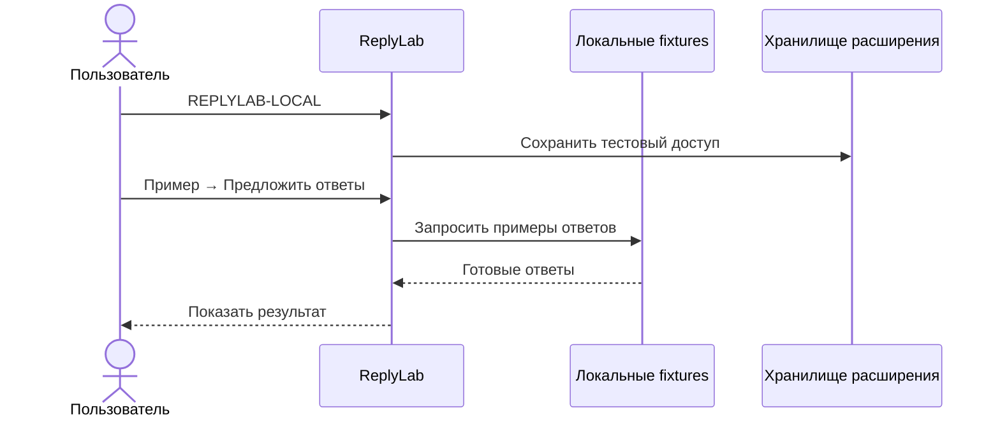
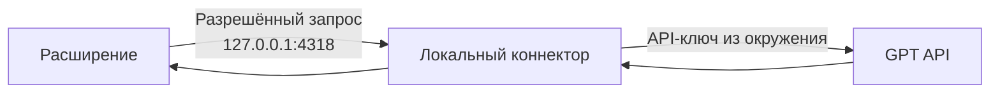

# Как работает ReplyLab

[← На главную](../README.md) · [English](README.en.md)

## Локальный режим

| Компонент | Задача |
|---|---|
| Интерфейс | Выбрать диалог, показать и скопировать ответ |
| Тестовый код | Включить доступ к локальным сценариям |
| Fixtures | Дать воспроизводимые диалоги и ответы |
| Хранилище расширения | Сохранить локальное состояние |

## Свой GPT

| Режим | Данные и доступ |
|---|---|
| **Локальный тест** | Fixtures, тестовый код `REPLYLAB-LOCAL`, без сети |
| **Свой GPT** | Текст текущего диалога, ваш API-ключ в локальном процессе, модель с указанным ID |

Проверка локального доступа находится в [`canUseApp(user)`](../extension/core.js). Она использует данные тестового профиля. Сценарии **Открыт**, **Пробный**, **Истёк**, **Выход** меняют только этот профиль.

Инструкция по коннектору: [подключить свой GPT](development.ru.md#подключить-свой-gpt). Проверки fixtures и локального API stub не подтверждают выполненный запрос к реальному GPT.
