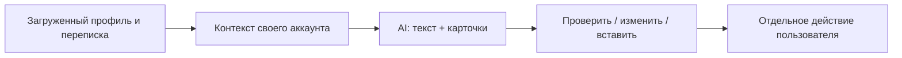
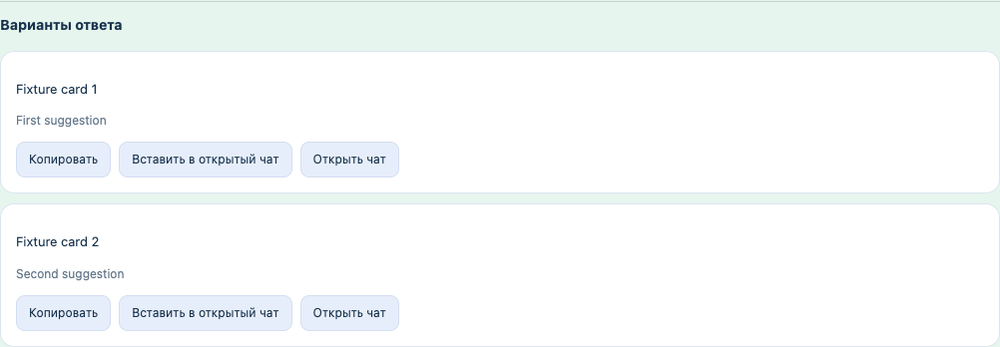

# Что добавлено в 0.4

[Главная](../README.md) · [Инструкция](development.ru.md) · [Проверки](validation.md)

| Был пробел | Теперь |
|---|---|
| Терялись поля профиля | Интересы, descriptors, profile prompts, Spotify, возраст/город и собственный профиль проходят capture/export/AI |
| Архив оставался старым | После явного Save новые загруженные сообщения того же известного аккаунта объединяются; архивная часть не удаляется |
| Только текст ассистента | Карточки вариантов, черновик стиля с редактором, видимые результаты поиска прошлых ответов |
| Смешивались аккаунты | Identity guard при import/sync/notes/queue; неизвестный WA требует отдельную локальную метку |
| Перезапись AI-хода | Изменение и повтор создают новую ветку, сохраняя оригинал |
| Каталог только локальный | Постоянный CRUD каталога и версионируемых шаблонов на своём сервере |
| Ограниченный импорт | Явный импорт до 50 уже загруженных чатов за порцию с датами и receipt |
| Язык подсказок был фиксирован | Автоязык по диалогу или явный выбор отдельно от языка интерфейса |
| Click считался концом очереди | Статус `sent` только после наблюдения нового исходящего; это не подтверждение доставки получателю |

**Реальная локальная модель проверена отдельно:** qwen3.5:4b Q4_K_M, через настоящий интерфейс/worker/gateway. Два английских ответа получены за 2166 мс на загруженной модели. Серверный assistant также вернул настоящие `printSuggestions` cards. Это ограниченная проверка на синтетическом тексте, не оценка качества на всех диалогах.

Тест стиля сначала выявил копирование заглушек и смешение фактов владельца с биографией собеседника. Инструкция и контекст исправлены: чужая биография исключается из создания переносимого стиля, известные заглушки отклоняются, сохранение требует просмотра. Повторный реальный запрос вернул пригодную английскую инструкцию с переменными владельца.

Не восстановлены закрытая историческая база, содержимое оригинального серверного каталога и post-login traffic. Они отсутствуют в поставленном клиенте. Своё API воссоздаёт функции хранения и генерации, а не выдаёт эти данные за найденные исходники. Живой оригинал и текущий DOM аккаунта остаются отдельной проверкой.
