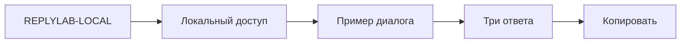
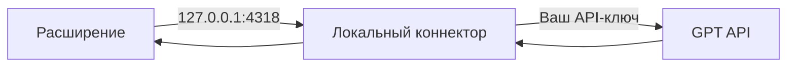

# Локальная проверка и свой GPT

[На главную](../README.md) · [English](README.en.md)

## Быстрый тест



1. Загрузите папку `extension` в `chrome://extensions`.
2. Откройте ReplyLab, введите **REPLYLAB-LOCAL**, нажмите **Включить тест**.
3. Нажмите **Пример**, затем **Предложить ответы**.

В режиме **Локальный тест** всё работает на устройстве. Аккаунт и API-ключ не нужны. Ответы являются fixtures для проверки интерфейса.

<details>
<summary>Проверить разные состояния доступа</summary>

Откройте **Сценарии доступа** внизу окна.

| Кнопка | Результат |
|---|---|
| Открыт | Доступ к генерации |
| Пробный | Пробный локальный профиль |
| Истёк | Генерация закрыта |
| Выход | Локальный профиль сброшен |

Контракт проверки находится в [`extension/core.js`](../extension/core.js): `canUseApp(user)`. Тестовый код выбирает локальный fixture. Он не является ключом доступа к внешнему API.

</details>

## Подключить свой GPT

Нужен Node.js 22+ и ваш действующий API-ключ. Модель должна поддерживать Chat Completions и JSON-ответ. Ключ остаётся в процессе локального коннектора, расширение его не хранит.

```sh
read -s OPENAI_API_KEY
export OPENAI_API_KEY
npm start
```

Введите свой ключ после первой команды и нажмите Enter. Символы не отображаются.

Затем в ReplyLab:

| Поле или кнопка | Значение |
|---|---|
| Источник | **Свой GPT** |
| Модель вашего API | Точный ID доступной вам модели |
| Разрешить локальный коннектор | Нажать один раз |
| Предложить ответы | Отправляет текущий фрагмент через ваш коннектор |



Реальный GPT требует действующих API-доступа и ключа. Локальный тестовый код их не заменяет. Запрос уходит только после нажатия **Предложить ответы** в режиме **Свой GPT**.

Контракт коннектора: [`scripts/gateway.mjs`](../scripts/gateway.mjs). Используется [официальный Chat Completions API](https://developers.openai.com/api/reference/resources/chat/subresources/completions/methods/create).

## Проверки

```sh
npm test
```

Установка зависимостей и сборка не требуются. Для остановки коннектора нажмите Ctrl+C.
