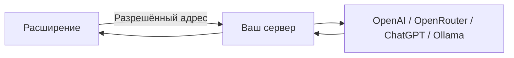

# GPT и локальные проверки

[Главная](../README.md) · [English](README.en.md) · [Возможности](features.md)

## Без аккаунта

`REPLYLAB-LOCAL` → **Включить тест** → **Пример** → **Предложить ответы**.

| Сценарий | Проверяется |
|---|---|
| **Открыт** | Генерация разрешена |
| **Пробный** | Пробный локальный профиль |
| **Истёк** | Генерация заблокирована |
| **Выход** | Локальный профиль сброшен |

Проверка находится в [`canUseApp(user)`](../extension/core.js). Это отдельный локальный контракт. Модель, аккаунт провайдера и внешние права этим кодом не создаются. Настоящий перевод требует подключённой модели.

## Подключить свой GPT



Откройте терминал в распакованной папке **ReplyLab**, где лежит `package.json`. Node.js должен быть версии 22 или новее. Установка npm-пакетов не требуется.

### Через API-ключ

```sh
read -s OPENAI_API_KEY
export OPENAI_API_KEY
npm start
```

После первой команды введите ключ и нажмите Enter. Он не отображается в терминале. Для OpenRouter вместо `OPENAI_API_KEY` используйте `OPENROUTER_API_KEY`.

| В расширении | Значение |
|---|---|
| **Подключения и разрешения → Мой сервер** | `http://127.0.0.1:4318` |
| **Разрешить мой сервер** | Подтвердить доступ к этому адресу |
| **Источник** | **Свой GPT** |
| **Настройки → Провайдер** | `openai` или `openrouter` |
| **Модель подсказок / Модель помощника** | ID из **Список моделей** |
| **Сохранить настройки** | После этого запрос готов |

Чтобы вводить API-ключ через интерфейс, сначала задайте `REPLYLAB_SERVER_TOKEN` в окружении сервера. В **Настройки → Токен моего сервера** сохраните тот же токен. В **Подключения и разрешения → Сохранить ключ у себя на сервере** введите ключ. Он сохраняется в приватном файле сервера, не в экспорте библиотеки.

### Вход через ChatGPT / OpenRouter

1. Запустите сервер: `npm start`.
2. Разрешите `http://127.0.0.1:4318` в расширении.
3. **Настройки → Подключения OAuth → ChatGPT OAuth** или **OpenRouter OAuth**.
4. Завершите вход в открытом окне. **Обновить аккаунты** → выбрать аккаунт.
5. Выберите провайдер `chatgpt` / `openrouter`, запросите список моделей, сохраните точный ID.

Используется официальный OAuth с PKCE. Доступность прямого inference и моделей определяется провайдером и выданными правами. Локальные тесты протокола не доказывают доступность конкретного аккаунта. Для ChatGPT ограничения проверяются по [официальной документации](https://developers.openai.com/siwc/token-sharing-open-source/preview-limitations).

### Локальный Ollama / совместимый сервер

```sh
export COMPATIBLE_API_BASE=http://127.0.0.1:11434/v1
# Для thinking-моделей Ollama, если хотите выключить рассуждение:
export COMPATIBLE_REASONING_EFFORT=none
npm start
```

В **Настройки** выберите `compatible`, затем точный ID установленной модели. Ollama должен уже работать. Loopback endpoint может использоваться без ключа. Разные модели поддерживают разные форматы JSON, изображения и параметры; ошибки не заменяются фиктивным AI-ответом.

## Данные, ссылки, расписание

| Действие | Где данные |
|---|---|
| История, заметки, стили, память | `chrome.storage.local` |
| **Экспорт библиотеки** | JSON-файл без ключей и токенов |
| **Разрешить синхронизацию** | Копия на вашем сервере, проверка каждую минуту |
| **Создать ссылку** | Отдельная копия чата с TTL 1–168 часов; можно отозвать |
| Автоматическое расписание | Требует разрешения устройства, видимой вкладки и известного аккаунта Tinder; для WhatsApp блокируется |

Loopback-ссылка открывается на вашем компьютере. Для внешней ссылки нужен ваш HTTPS-сервер и `PUBLIC_URL`; для сетевого bind также обязателен `REPLYLAB_SERVER_TOKEN`. Пример: `REPLYLAB_HOST=0.0.0.0`, `PUBLIC_URL=https://your-host.example`. TLS завершает ваш reverse proxy. Перед публикацией чата проверьте его содержимое.

Сервер хранит `.replylab/` рядом с запуском: библиотеку, ссылки, credential vault и OAuth. Папка исключена из Git, каталоги имеют режим 700, приватные файлы 600. При переносе сервера или устройства импорт библиотеки не выдаёт разрешение на автоматическую отправку и синхронизацию.

## Проверки

```sh
npm test
```

Дополнительный интеграционный сценарий использует Chrome for Testing и уже установленный `playwright-core`:

```sh
PLAYWRIGHT_MODULE=/absolute/path/to/playwright-core/index.mjs \
CHROME_PATH='/absolute/path/to/Chrome for Testing' \
node tests/browser.mjs
```

Он создаёт изолированную копию расширения с тестовыми host permissions. Сайт, его состояние и AI-транспорт синтетические. Фоновый обработчик, HTTP-сервер, поток, сохранение, экспорт, поиск и отзыв ссылки настоящие. Реальные аккаунты и отправка сообщений не используются. Остановка сервера: Ctrl+C.

## Стили, история и аккаунты

| Задача | Действие |
|---|---|
| Получить карточки от ассистента | Выбрать сохранённый контекст → попросить варианты → проверить карточки → **Вставить в открытый чат** |
| Создать стиль | Выбрать задачу **Создать стиль** → **Открыть черновик в редакторе** → проверить → **Сохранить стиль** |
| Исправить запрос / повторить ответ | **Изменить в новой ветке** / **Повторить в новой ветке**. Старый диалог сохраняется |
| Похожие прошлые ответы | Отдельно разрешить поиск на этот запрос. По умолчанию только подтверждённый текущий аккаунт |
| Каталог и шаблоны | **Стили → Каталог стилей на моём сервере**; записи сохраняются на вашем сервере, не являются чужим публичным каталогом |
| Собственный профиль | Выбрать сохранённый контекст → **Объект анализа → Мой профиль аккаунта** |
| Импорт истории | В панели **Импорт загруженных диалогов**: до 50 за порцию, фильтр дат, отчёт. Дополнительные запросы к сайту не выполняются |

Переменные стиля поддерживают `{name}` и `{{name}}`. Доступны `name`, `bio`, `personName`, `personBio`, `matchName`, `accountName`, `accountBio`, `aboutAccountProfile`, `aboutPersonProfile`, `matchRichFields`, `transcript`, `platform`, `datetime`, `notes`, `memories`. Неизвестные значения не выдумываются; нераспознанные переменные сохраняются в тексте для проверки.

Метка WhatsApp нужна только для сохранения/заметок неизвестного аккаунта. Выберите разные метки для разных аккаунтов. Метка не выдаёт права на автоотправку, поиск от имени подтверждённого аккаунта или вставку из другой вкладки. Старые записи можно просмотреть и экспортировать.

Для воспроизводимого теста с настоящей локальной моделью используйте уже установленный `playwright-core` и Chrome for Testing:

```sh
PLAYWRIGHT_MODULE=/absolute/path/to/playwright-core/index.mjs \
CHROME_PATH='/absolute/path/to/Chrome for Testing' \
COMPATIBLE_API_BASE=http://127.0.0.1:11434/v1 \
COMPATIBLE_REASONING_EFFORT=none \
REPLYLAB_LIVE_MODEL=qwen3.5:4b \
node tests/live-model.mjs
```

Модель должна уже быть установлена в Ollama. Скрипт не скачивает её, использует синтетический текст и временную копию расширения, запускает/останавливает свой loopback gateway. Обычный `npm test` реальную модель не вызывает.
