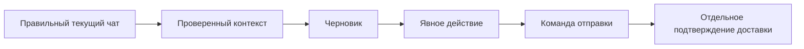

# Аналоги, готовый код и грабли

[Главная](../README.md) · Проверено **07.11.2026** · Чужие проекты не запускались.

Исследованы исходники и лицензии, а не только описания проектов. Ниже аналоги для сравнения; исходный сервер исследуемого продукта не найден. Полный опубликованный клиент был сохранён отдельно. Присланный позднее ZIP оказался 194-байтным архивом с пустым CRX.

| Проект | Что проверено в коде | Польза / ограничение |
|---|---|---|
| [WhatsApp Web AI Assistant](https://github.com/silham/WhatsApp-Web-AI-Assistant/tree/8128b7e3167990c8f820d069b367e71bb9441b28) | Provider factory, worker, timestamps/settings, тесты. Commit от 13.09.2026, MIT | Высокий ROI: разделение адаптера и AI, fixtures. Ключи в Chrome sync storage переносить не стоит |
| [WhatsApp Follow-up Assistant](https://github.com/Aatif-wani/whatsapp-followup-assistant/tree/55d9ebeef328adb21c7f0d4b28a6f43c60fe88c5) | Observer переживает замену DOM-корня, отдельный adapter. Commit от 23.07.2026 | Полезен lifecycle. Вставка очищает draft. MIT заявлен в README, отдельный LICENSE не найден |
| [Kaption](https://github.com/Kaption-AI/mcp-extension/tree/429c4bc05836438f3ee929db1195ab48f4c0a249) | Account/session routing, queue ID отдельно от доставки, skill/tool contracts. Commit от 02.11.2026 | Полезен как reference. Текущая лицензия BSL 1.1 ограничивает конкурентное использование; будущий MIT ещё не разрешение |
| [ChatGPT Tinder Bot](https://github.com/TheExplainthis/ChatGPT-Tinder-Bot/tree/0e1886aae686c3984b4c8b2bfe04e9129a8f482e) | Нормализация участников в роли, private API, автоматическая отправка. Commit от 18.03.2023, MIT | Полезна нормализация контекста. Старый транспорт не является проверенным фундаментом сегодня |
| [tinder_extension](https://github.com/rushout09/tinder_extension/tree/50de5a962d25cad1ece8794a62d234722859612e) | Фиксированные DOM ID, замена кнопки, credential-подобный literal. Commit от 04.01.2024, LICENSE не найден | Не копировать целиком: хрупкость, риск чужого секрета, неясное разрешение на reuse |

В ReplyLab использованы собственные реализации. Чужие блоки кода из этих аналогов не переносились. MIT при переносе кода требует сохранения notices; публичность GitHub сама по себе лицензией не является.

## Почему паузы не дают защиты от блокировки

| Свидетельство | Что из него следует |
|---|---|
| [Tinder Terms, §2c](https://tinder.com/terms/intl/en/) · действует с 05.03.2026 | Ограничены bots, неразрешённые API и сторонние AI-интеграции с сервисом. Ручная отправка сама по себе не означает разрешённость интеграции |
| [WhatsApp: временные блокировки](https://faq.whatsapp.com/1848531392146538/) | Неофициальные приложения и неразрешённое извлечение данных могут приводить к ограничению аккаунта |
| [wwebjs #4008](https://github.com/wwebjs/whatsapp-web.js/issues/4008) · 08.12.2025 | Автор сообщает о 24-часовой блокировке примерно после трёх сообщений. Причина и вероятность независимо не установлены |
| [wwebjs #981](https://github.com/wwebjs/whatsapp-web.js/issues/981) · 20.11.2021 | Автор сообщает о блокировке после пяти сообщений, несмотря на случайные паузы. Это старый report, не лимит для текущей платформы |
| [ZapZap #769](https://github.com/rafatosta/zapzap/issues/769) · обсуждение 2026 года | Есть противоречивые отчёты; maintainer не считает причинную связь доказанной. По anecdotes нельзя определить точный триггер |

**Гарантии отсутствия банов нет.** Не найдено проверенного безопасного числа сообщений или задержки. Подмена fingerprint, ротация аккаунтов и обход блокировок не добавлялись.

Практические меры ReplyLab: автоматизация выключена изначально; фото и сеть требуют выбора; изменившиеся входящие блокируют автоотправку; существующий draft защищён; queue ACK не считается доставкой; повтор после неопределённого результата не выполняется. Это защита от ошибок приложения, не сертификация платформой.

## Инструменты и скиллы

| Проверенный источник | Применение |
|---|---|
| [REA от morluto](https://github.com/morluto/rea), [официальный skill](https://skills.sh/morluto/rea/reverse-engineer-anything) | Инвентаризация опубликованного пакета, evidence и анализ отдельных функций. Установлен ранее |
| [Wakaru](https://github.com/pionxzh/wakaru), [webcrack](https://github.com/j4k0xb/webcrack) | Статическая распаковка bundles в отдельные каталоги. Не возвращают отсутствующий сервер или Git history |
| [GoogleChrome: Chrome Extensions](https://github.com/GoogleChrome/modern-web-guidance/tree/main/skills/chrome-extensions) | Проверен и установлен 07.11.2026: MV3, permissions, messaging, storage, worker lifecycle |
| [CRX Viewer](https://github.com/Rob--W/crxviewer) | Просмотр поставляемого кода без установки целевого расширения |

Поиск скиллов выполнен через skills.sh и `skills find chrome-extension`. Выбран официальный источник; дополнительные похожие скиллы не дают гарантии совместимости или отсутствия банов. Новый скилл доступен Codex со следующего хода.

## Что остаётся проверить на живом аккаунте

- Действующий DOM и внутренние структуры текущей версии Tinder / WhatsApp.
- Ответы оригинального сервера после авторизации, включая динамические шаблоны и скрипты.
- Доступность OAuth и inference для конкретного аккаунта и выбранной модели.

В изолированном запуске оригинала без входа наблюдались каталог моделей и конфигурация флагов. Основная логика расширения не была замечена среди загруженных удалённых скриптов; это не исключает её загрузку после входа. Результаты синтетического теста нельзя выдавать за такую проверку.
